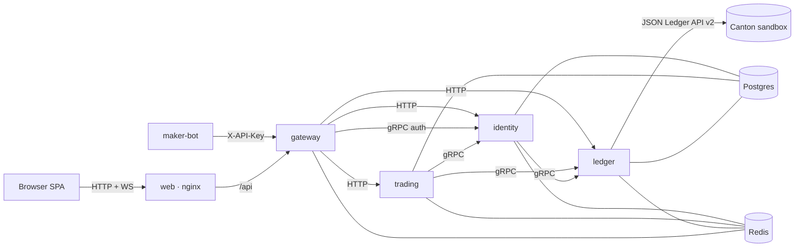

# Private OTC Desk for Canton

[](https://github.com/vbloher/canton-private-otc-desk/actions/workflows/ci.yml)


A confidential request-for-quote desk for large token swaps on [Canton Network](https://www.canton.network).
A taker asks the makers they choose for a price, accepts the best quote, and the swap settles
atomically (delivery versus payment) in a single Canton transaction. Nobody outside the trade
sees the price or the counterparty.

Wallets are self-custodial: a user's Ed25519 party key is generated in the browser, wrapped
with a passkey (WebAuthn PRF) and never leaves it. Every ledger action of a user is an
interactive submission — the desk prepares it, the browser signs it, the desk executes it.

This repository is a deliberately small open-source implementation: Go microservices built on
[Clean Architecture](https://github.com/vbloher/go-clean-architecture-template), a layered React
SPA, and a local Canton sandbox with the token-standard test rail.

## Features

- **Passkey wallet** — create a wallet (an external Canton party) with a passkey; connect it
  again later with the same passkey. No passwords, no e-mail.
- **RFQ trading** — buy or sell any instrument pair, ask several makers at once, see quotes
  appear live, accept the best one.
- **Atomic settlement** — a quote is the maker's committed token-standard v2 allocation; the
  accept adds the taker's; the desk settles every leg in one `SettlementFactory_SettleBatch`
  transaction. All or nothing.
- **Maker mode** — any wallet can become a maker and quote from the browser; bots quote over
  the same API with an API key. A demo maker bot quotes for the two house makers.
- **Wallet** — balances (available and locked), test-token faucet, deposits (accept incoming
  transfers) and withdrawals to any Canton party.
- **Live updates** — a WebSocket pushes RFQ, quote, trade and signing events.

## Architecture



| Service | Responsibility | Ports |
|---|---|---|
| `gateway` | single public origin: authenticates the session cookie or API key, forwards the caller to the services, hosts the WebSocket fed by Redis pub/sub | HTTP 8080 |
| `identity` | passkey wallets, sessions, challenges, house makers, maker mode | HTTP 8081 · gRPC 9081 |
| `trading` | RFQs, quotes, trades and the settlement worker | HTTP 8082 |
| `ledger` | everything Canton: parties, holdings, transfers, allocations, settlement, the sign queue | HTTP 8083 · gRPC 9083 |
| `maker-bot` | demo market maker for `makerA` and `makerB` | — |
| `web` | the SPA behind nginx, which also proxies `/api` | 3000 |

Each service follows the template's layout — `cmd/app`, `config`, `internal/{app,domain,dto,
usecase,adapter,controller}`, `migration` — with ports declared by the use cases and implemented
by adapters. Postgres holds one database per service; Redis is the cache (sessions, desk facts,
the registry contract), the store for one-shot challenges and the event bus. HTTP contracts are
OpenAPI (`api/http`, servers and clients generated with oapi-codegen); internal contracts are
protobuf (`api/grpc`).

### How a trade settles

1. The taker creates an RFQ (`BUY 0.5 CBTC` against `USDCx`) for chosen makers.
2. A maker quotes a price. The quote is the maker's **committed allocation** on the ledger, so
   a quote is always funded; the taker sees it once it lands.
3. The taker accepts. The taker (and, for the fee, the desk) allocate their sides.
4. The desk, the settlement's only executor, settles every leg — base, quote notional and the
   desk fee — in one transaction. Losing quotes are cancelled and their funds released.

The fee (`FEE_BPS`, default 10) is paid by the maker in the quote asset. Amounts are exact
decimals with ten fraction digits, floored like Daml's `Numeric 10`.

## Quick start

Requirements: Docker, [DPM](https://docs.digitalasset.com) with Daml SDK 3.5.2
(`curl https://get.digitalasset.com/install/install.sh | sh`, then `dpm install 3.5.2`, Java 21),
and a browser with passkeys that support the PRF extension (Chrome, Edge, Safari 18+).

```bash
make ledger    # terminal 1: Canton sandbox + test tokens + demo parties (keep it running)
make up-all    # terminal 2: Postgres, Redis, the services, the maker bot and the web app
```

`make up-all` works on macOS (Docker Desktop, OrbStack) and Linux: on Linux it adds
[`docker-compose.host.yml`](docker-compose.host.yml), which puts the app containers on the host
network — bound to 127.0.0.1 — so they can reach the sandbox on the host's loopback. Either way
nothing listens beyond 127.0.0.1: the web app (:3000), the gateway (:8080), Postgres (:5432) and
Redis (:6379) — and on Linux also the services' own ports (8081–8083, 9081, 9083), which any
local process can reach, so run it on a single-user machine.

The sandbox keeps its ledger in memory. If you restart `make ledger`, the wallets in the
database point at parties that no longer exist: run `make clean` (drops the databases) and
`make up-all` again.

Open <http://localhost:3000>:

1. **Create wallet** — pick a name and confirm the passkey prompt.
2. **Wallet → Get test tokens** — 1 CBTC, 100 000 USDCx and 10 CETH arrive once the
   auto-signer accepts the offers.
3. **Request quotes** — e.g. buy 0.1 CBTC for USDCx from `makerA` and `makerB`. The maker bot
   answers within a second.
4. **Accept** the best quote and watch the trade settle; balances move in one transaction.
5. Optional: turn **maker mode** on in a second browser profile and quote from the UI.

## Development

Requirements: Go 1.27.3, Node 24 with `corepack enable` (pnpm's version is pinned in
`web/package.json`), plus the quick-start requirements.

```bash
make bin-deps            # protoc and golangci-lint into ./bin
make ledger              # Canton sandbox
make up                  # Postgres and Redis only (127.0.0.1)
make run-ledger          # each in its own terminal: run-ledger, run-identity, run-trading,
make run-identity        # run-gateway, run-maker-bot (each creates services/<name>/.env from the example)
make web-dev             # Vite on :3000, proxying /api to the gateway on :8080
```

| Command | Description |
|---|---|
| `make test` | Go unit tests (race detector, shuffled like CI) |
| `make integration-test` | service tests against real Postgres and Redis (`make up`) |
| `make sandbox-test` | ledger adapter tests against the running sandbox |
| `make e2e-test` | black-box end-to-end suite against the running stack |
| `make lint` | golangci-lint |
| `make generate` | regenerate protobuf, OpenAPI servers/clients and mocks |
| `make vuln` | govulncheck (pinned as a Go tool) |
| `make clean` | stop the stack and drop its databases |
| `pnpm --dir web test` | web unit tests (`lint`, `typecheck`, `build`, `gen:api` likewise) |

To change an HTTP API, edit `api/http/<name>_v1.yaml` and run `make generate` (and
`pnpm --dir web gen:api`); the compiler then points at every handler that no longer matches.

## API

Everything is served by the gateway under `/api/v1`. Browsers authenticate with the
`otc_session` cookie; bots send `X-API-Key`. The sandbox's house makers have the keys
`demo-key-a` (`makerA`) and `demo-key-b` (`makerB`).

```bash
# a bot looks for RFQs it was asked to quote and answers one
curl -s -H 'X-API-Key: demo-key-a' localhost:8080/api/v1/rfqs/incoming
curl -s -H 'X-API-Key: demo-key-a' -H 'content-type: application/json' \
  -d '{"price":"100150.0","ttlSeconds":60}' localhost:8080/api/v1/rfqs/<rfqId>/quotes
```

| Area | Contract |
|---|---|
| wallets, sessions, makers | [`api/http/identity_v1.yaml`](api/http/identity_v1.yaml) |
| RFQs, quotes, trades | [`api/http/trading_v1.yaml`](api/http/trading_v1.yaml) |
| balances, transfers, signing | [`api/http/wallet_v1.yaml`](api/http/wallet_v1.yaml) |
| WebSocket `/api/v1/ws` | `{"type": "rfq.created" \| "rfq.updated" \| "quote.updated" \| "trade.updated" \| "sign.requested" \| "sign.completed" \| "wallet.updated", "data": {...}}` |

## Configuration

Every service reads environment variables (and `.env` in its directory when present).
Common: `HTTP_HOST` (empty = every interface) and `HTTP_PORT`, `LOGGER_LEVEL` (info),
`LOGGER_PRETTY_CONSOLE`, `OTEL_ENDPOINT`, `OTEL_SERVICE_NAME`,
`POSTGRES_HOST/PORT/USER/PASSWORD/DB_NAME`, `REDIS_ADDR`; services with gRPC also take
`GRPC_HOST` and `GRPC_PORT`. The gateway takes `CORS_ORIGINS` (frontends on other origins).
The web image takes `NGINX_HOST`, `NGINX_PORT` (80) and `GATEWAY_UPSTREAM` (gateway:8080); a
web build takes `VITE_API_URL` (gateway origin, empty = same origin), `VITE_BASE` (path prefix)
and `VITE_DEPLOY=pages`.

| Service | Variables (defaults) |
|---|---|
| identity | `GRPC_PORT` (9081), `LEDGER_GRPC_ADDR` (localhost:9083), `HOUSE_MAKERS` (makerA:demo-key-a,makerB:demo-key-b), `SESSION_TTL` (168h), `COOKIE_SECURE` (false) |
| ledger | `GRPC_PORT` (9083), `CANTON_URL` (http://localhost:6864), `CANTON_USER_ID` (participant_admin), `OPERATOR_HINT` (operator), `HOUSE_PARTIES` (makerA,makerB), `INSTRUMENTS` (CBTC:Bitcoin:8,USDCx:USD Coin:2,CETH:Ether:6), `FAUCET_AMOUNTS` (CBTC:1,USDCx:100000,CETH:10), `ACTION_TTL` (10m) |
| trading | `LEDGER_GRPC_ADDR` (localhost:9083), `IDENTITY_GRPC_ADDR` (localhost:9081), `FEE_BPS` (10), `WORKER_INTERVAL` (1s), `SETTLE_TIMEOUT` (10m) |
| gateway | `IDENTITY_GRPC_ADDR` (localhost:9081), `IDENTITY_URL`, `TRADING_URL`, `LEDGER_URL` (localhost:8081–8083) |
| maker-bot | `GATEWAY_URL` (http://localhost:8080), `MAKER_KEYS` (demo-key-a:15,demo-key-b:40 — key:spread bps), `PRICES_USD` (CBTC:100000,CETH:4000,USDCx:1), `QUOTE_TTL` (60s), `POLL_INTERVAL` (1s) |

## Deployment

### Web app on GitHub Pages

[`pages.yml`](.github/workflows/pages.yml) builds `web/` and publishes it to GitHub Pages on
every push to `master` that touches the web app (or by hand: **Actions → Pages → Run workflow**),
at `https://<owner>.github.io/<repo>/`. Pages serves static files only, so the app talks to a
gateway you host elsewhere:

0. Once: **Settings → Pages → Source: GitHub Actions**
   (or `gh api -X POST repos/<owner>/<repo>/pages -f build_type=workflow`).
1. Run the backend somewhere reachable over HTTPS (see below), behind a TLS-terminating proxy
   that also passes WebSocket upgrades on `/api/v1/ws` and does not log the
   `Sec-WebSocket-Protocol` header (it carries the session token).
2. On the gateway set `CORS_ORIGINS=https://<owner>.github.io` (comma-separated for several).
3. Set the repository variable `API_URL` to the gateway's origin and re-run the Pages workflow:

   ```bash
   gh variable set API_URL --body https://desk.example.com
   gh workflow run pages.yml
   ```

Until `API_URL` is set the site deploys anyway and says that no desk is connected.

The session cookie is `SameSite=Lax`, so no browser sends it on a request from another site.
When the gateway is on another origin the app therefore keeps the session token from sign-in
in `sessionStorage` and sends it as `Authorization: Bearer …`, and the WebSocket carries it as a
subprotocol. The session is per tab: a new tab asks for the passkey again, and signing out ends
that tab's session. A same-origin deployment (docker-compose, nginx) keeps using the HttpOnly
cookie only.

`https://<owner>.github.io` is one origin for every Pages site of that owner: `CORS_ORIGINS`,
the passkeys' relying-party id and the browser storage are shared with all of them, and a
wallet created there opens on any of them. For a real deployment use a custom domain.

### Images

[`release.yml`](.github/workflows/release.yml) publishes a multi-arch image per service and one
for the web app to the GitHub Container Registry:

| Trigger | Tags |
|---|---|
| push to `master` | `edge`, `sha-<short>` |
| tag `v1.2.3` | `1.2.3`, `1.2`, `latest`, `sha-<short>` |

`edge` follows `master` whether or not CI passed on that commit; tags are the stable channel.
Each image is linked to this repository and takes its visibility, so they are public here (a
private fork's images stay private until changed in the package settings):

```bash
docker pull ghcr.io/vbloher/canton-private-otc-desk/gateway:edge   # gateway, identity, trading, ledger, maker-bot, web
```

`docker-compose.yml` shows how they fit together. A public deployment needs at least: a
Canton participant (`CANTON_URL`) with the token rail, `COOKIE_SECURE=true` on identity,
`CORS_ORIGINS` on the gateway, your own `HOUSE_MAKERS` keys, and nothing but the gateway
reachable from outside.

## Repository layout

```
api/            OpenAPI and protobuf contracts
gen/            generated servers, clients and gRPC stubs
pkg/            shared infrastructure (logger, metrics, otel, postgres, redis, transactions,
                decimal money math, events, principal headers, gRPC helpers, migrations)
services/       gateway, identity, trading, ledger, maker-bot
web/            React SPA: domain / application / infrastructure / presentation
daml/           vendored token-standard DARs, the sandbox test token, the demo seed
scripts/        sandbox start script
test/e2e/       end-to-end suite
docs/           design and plan
```

## Limits

This is a reference implementation for a local sandbox, kept small on purpose:

- One target: the local Canton sandbox, where a `TokenRules` contract plays the token registry.
  Real networks need OAuth for the ledger and the registries' HTTP APIs.
- It is a local demo, not a hardened deployment: the house makers' API keys are public
  defaults, anyone signed in can mint test tokens, and identity, trading and ledger trust the
  caller headers the gateway sets — never expose them (or the sandbox) beyond your machine.
- The browser signs prepared-transaction hashes without decoding them; a production wallet
  should show the user what it signs. A prepared transaction waits for its signature for up to
  `ACTION_TTL` (10 min); the sandbox accepted signatures 90 s after preparation in testing, but
  real networks may enforce a shorter window.
- Losing your passkey loses the wallet: there is no backup phrase or recovery.
- No invites, rate limiting, e-mail or KYC.

## License

[GPL-3.0](LICENSE). `daml/deps` and `daml/test-token-v2` are vendored from
[Splice](https://github.com/hyperledger-labs/splice) under Apache-2.0.
