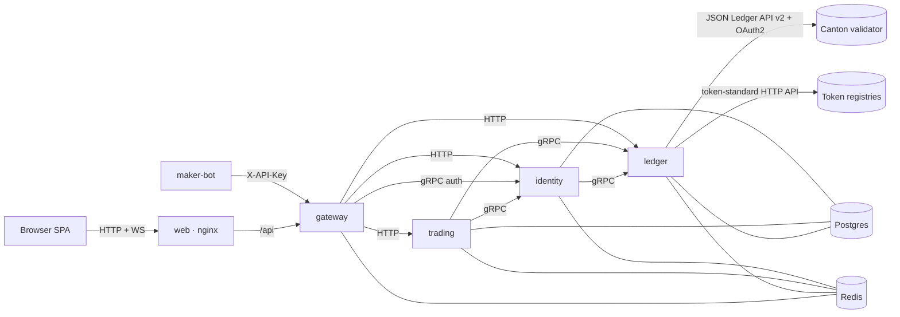

# Private OTC Desk for Canton

[](https://github.com/vbloher/canton-private-otc-desk/actions/workflows/ci.yml)


A confidential request-for-quote desk for large token swaps on [Canton Network](https://www.canton.network).
A taker asks the makers they choose for a price, accepts the best quote, and the swap settles
atomically (delivery versus payment) in a single Canton transaction. Nobody outside the trade
sees the price or the counterparty.

Wallets are self-custodial: a user's Ed25519 party key is generated in the browser, wrapped
with a passkey (WebAuthn PRF) and never leaves it. Every ledger action of a user is an
interactive submission — the desk prepares it, the browser signs it, the desk executes it.

This repository is a deliberately small open-source implementation: Go microservices built on
[Clean Architecture](https://github.com/vbloher/go-clean-architecture-template) and a layered React
SPA. It runs against a real Canton network — DevNet, TestNet or MainNet — through your own
validator's JSON Ledger API and the instruments' token-standard registries.

## Features

- **Passkey wallet** — create a wallet (an external Canton party) with a passkey; connect it
  again later with the same passkey. No passwords, no e-mail.
- **RFQ trading** — buy or sell any instrument pair, ask several makers at once, see quotes
  appear live, accept the best one.
- **Atomic settlement** — a quote is the maker's committed token-standard v2 allocation; the
  accept adds the taker's; the desk settles every leg in one `SettlementFactory_SettleBatch`
  transaction. All or nothing.
- **Maker mode** — any wallet can become a maker and quote from the browser; bots quote over
  the same API with an API key. The desk's own maker is one hosted party with one API key; a demo
  maker bot quotes for it on DevNet.
- **Wallet** — balances (available and locked), deposits (accept incoming transfers),
  withdrawals to any Canton party, and on DevNet a test-token faucet.
- **Live updates** — a WebSocket pushes RFQ, quote, trade and signing events.

## Architecture



| Service | Responsibility | Ports |
|---|---|---|
| `gateway` | single public origin: authenticates the session cookie or API key, forwards the caller to the services, hosts the WebSocket fed by Redis pub/sub | HTTP 8080 |
| `identity` | passkey wallets, sessions, challenges, the house maker, maker mode | HTTP 8081 · gRPC 9081 |
| `trading` | RFQs, quotes, trades and the settlement worker | HTTP 8082 |
| `ledger` | everything Canton: parties, holdings, transfers, allocations, settlement, the sign queue | HTTP 8083 · gRPC 9083 |
| `maker-bot` | demo market maker: quotes for the house maker over the public API | — |
| `web` | the SPA behind nginx, which also proxies `/api` | 3000 |

Each service follows the template's layout — `cmd/app`, `config`, `internal/{app,domain,dto,
usecase,adapter,controller}`, `migration` — with ports declared by the use cases and implemented
by adapters. Postgres holds one database per service; Redis is the cache (sessions, desk facts,
the synchronizer id), the store for one-shot challenges and faucet cooldowns, and the event bus. HTTP contracts are
OpenAPI (`api/http`, servers and clients generated with oapi-codegen); internal contracts are
protobuf (`api/grpc`).

### How a trade settles

1. The taker creates an RFQ (`BUY 0.5 CBTC` against `USDCx`) for chosen makers.
2. A maker quotes a price. The quote is the maker's **committed allocation** on the ledger, so
   a quote is always funded; the taker sees it once it lands.
3. The taker accepts. The taker (and, for the fee, the desk) allocate their sides.
4. The desk, the settlement's only executor, settles every leg — base, quote notional and the
   desk fee — in one transaction: one `SettlementFactory_SettleBatch` per instrument admin, all
   in a single submission. Losing quotes are cancelled and their funds released.

Every factory and choice context comes from the instrument's registry (DA Utilities for CBTC
and USDCx, Splice Scan for Canton Coin), so the desk holds no token logic of its own.

The fee (`FEE_BPS`, default 10) is paid by the maker in the quote asset. Amounts are exact
decimals with ten fraction digits, floored like Daml's `Numeric 10`.

## Networks

The desk needs a validator on the network it trades on and an OAuth2 client of that validator's
identity provider (client credentials; the token's `sub` is the ledger user unless
`CANTON_USER_ID` says otherwise). On that participant:

1. Allocate the hosted parties the desk signs for — the operator, the house maker and, on DevNet,
   the faucet reservoir — and grant the ledger user `actAs` on each (`POST /v2/parties`,
   `POST /v2/users/{user}/rights`). Put their full party ids in `OPERATOR_PARTY`, `MAKER_PARTY` and
   `FAUCET_PARTY`. The ledger service waits for them on start and names the ones it cannot find.
2. Give the ledger user the rights to allocate external parties: every wallet is one.
3. Vet the [DA Utility Registry DARs](https://get.digitalasset.com/utility-dars/) so its parties
   can hold CBTC and USDCx.
4. Fund the house maker and the faucet reservoir with the instruments they quote and hand out.

`INSTRUMENTS` lists what the desk trades, one `SYMBOL|Name|decimals|instrumentId|admin|registryURL`
entry per instrument, comma-separated. The registry URL is the root of the token-standard API,
ending in `/registry`; a registry's `GET <root>/metadata/v1/info` names its admin. The templates
carry the DevNet values (CBTC and USDCx on the DA Utilities registries, CC on Splice Scan) and the
MainNet value for CC.

| Network | Template | Faucet |
|---|---|---|
| DevNet | [`deploy/.env.devnet.example`](deploy/.env.devnet.example), [`services/ledger/.env.example`](services/ledger/.env.example) | `FAUCET_PARTY` + `FAUCET_AMOUNTS`, one drip per `FAUCET_COOLDOWN` |
| MainNet | [`deploy/.env.mainnet.example`](deploy/.env.mainnet.example) | off |

## Quick start

Requirements: Docker, the validator access above, and a browser with passkeys that support the
PRF extension (Chrome, Edge, Safari 18+).

```bash
make env       # services/<name>/.env from the examples
$EDITOR services/ledger/.env services/identity/.env services/maker-bot/.env
make up-all    # Postgres, Redis, the services, the maker bot and the web app
```

In `services/ledger/.env` fill in `CANTON_URL`, the `CANTON_AUTH_*` client and the party ids
(`OPERATOR_PARTY`, `MAKER_PARTY`, `FAUCET_PARTY`). The house maker signs in with an API key: put
the same `MAKER_PARTY` and a key (`openssl rand -hex 32`) in `services/identity/.env`, and that key
in `MAKER_API_KEY` of `services/maker-bot/.env`. Compose reads every
service's `.env` and overrides only the addresses. Nothing listens beyond 127.0.0.1: the web app
(:3000), the gateway (:8080), Postgres (:5432) and Redis (:6379).

Open <http://localhost:3000>:

1. **Create wallet** — pick a name and confirm the passkey prompt.
2. **Wallet → Get test tokens** — the faucet's drip arrives once the auto-signer accepts it.
3. **Request quotes** — e.g. buy 0.001 CBTC for USDCx from the house maker. The maker bot
   answers within a second.
4. **Accept** the best quote and watch the trade settle; balances move in one transaction.
5. Optional: turn **maker mode** on in a second browser profile and quote from the UI.

## Development

Requirements: Go 1.27.3, Node 26 with corepack (`npm install -g corepack && corepack enable`;
pnpm's version is pinned in `web/package.json`), plus the quick-start requirements.

```bash
make bin-deps            # protoc and golangci-lint into ./bin
make up                  # Postgres and Redis only (127.0.0.1)
make run-ledger          # each in its own terminal: run-ledger, run-identity, run-trading,
make run-identity        # run-gateway, run-maker-bot (each creates services/<name>/.env from the example)
make web-dev             # Vite on :3000, proxying /api to the gateway on :8080
```

| Command | Description |
|---|---|
| `make test` | Go unit tests (race detector, shuffled like CI) |
| `make integration-test` | service tests against real Postgres and Redis (`make up`) |
| `make lint` | golangci-lint |
| `make generate` | regenerate protobuf, OpenAPI servers/clients and mocks |
| `make vuln` | govulncheck (pinned as a Go tool) |
| `make clean` | stop the stack and drop its databases |
| `pnpm --dir web test` | web unit tests (`lint`, `typecheck`, `build`, `gen:api` likewise) |

To change an HTTP API, edit `api/http/<name>_v1.yaml` and run `make generate` (and
`pnpm --dir web gen:api`); the compiler then points at every handler that no longer matches.

## API

Everything is served by the gateway under `/api/v1`. Browsers authenticate with the
`otc_session` cookie; the maker sends `X-API-Key: $MAKER_API_KEY`.

```bash
curl -s -H "X-API-Key: $KEY" localhost:8080/api/v1/rfqs/incoming
curl -s -H "X-API-Key: $KEY" -H 'content-type: application/json' \
  -d '{"price":"100150.0","ttlSeconds":60}' localhost:8080/api/v1/rfqs/<rfqId>/quotes
```

| Area | Contract |
|---|---|
| wallets, sessions, makers | [`api/http/identity_v1.yaml`](api/http/identity_v1.yaml) |
| RFQs, quotes, trades | [`api/http/trading_v1.yaml`](api/http/trading_v1.yaml) |
| balances, transfers, signing | [`api/http/wallet_v1.yaml`](api/http/wallet_v1.yaml) |
| WebSocket `/api/v1/ws` | `{"type": "rfq.created" \| "rfq.updated" \| "quote.updated" \| "trade.updated" \| "sign.requested" \| "sign.completed" \| "wallet.updated", "data": {...}}` |

## Configuration

Every service reads environment variables (and `.env` in its directory when present).
Common: `HTTP_HOST` (empty = every interface) and `HTTP_PORT`, `LOGGER_LEVEL` (info),
`LOGGER_PRETTY_CONSOLE`, `OTEL_ENDPOINT` (OTLP/gRPC address of the collector, empty = export
nothing; compose sets `otel-collector:4317`), `OTEL_SERVICE_NAME`, `OTEL_RATIO` (1.0),
`POSTGRES_HOST/PORT/USER/PASSWORD/DB_NAME`, `REDIS_ADDR`; services with gRPC also take
`GRPC_HOST` and `GRPC_PORT`. The web image takes `NGINX_HOST`, `NGINX_PORT` (80) and
`GATEWAY_UPSTREAM` (gateway:8080).

| Service | Variables (defaults) |
|---|---|
| identity | `GRPC_PORT` (9081), `LEDGER_GRPC_ADDR` (localhost:9083), `MAKER_PARTY` and `MAKER_API_KEY` (none — no house maker), `SESSION_TTL` (168h), `COOKIE_SECURE` (false) |
| ledger | `GRPC_PORT` (9083), `CANTON_NETWORK` (devnet; testnet, mainnet), `CANTON_URL` (required), `CANTON_USER_ID` (the token's `sub`), `CANTON_AUTH_TOKEN_URL`, `CANTON_AUTH_CLIENT_ID`, `CANTON_AUTH_CLIENT_SECRET`, `CANTON_AUTH_AUDIENCE`, `CANTON_AUTH_SCOPE` (no auth without a token URL), `OPERATOR_PARTY` (required), `MAKER_PARTY` (none), `INSTRUMENTS` (required), `FAUCET_PARTY` (none — faucet off), `FAUCET_AMOUNTS` (none — `SYMBOL:amount`), `FAUCET_COOLDOWN` (1h), `ACTION_TTL` (10m) |
| trading | `LEDGER_GRPC_ADDR` (localhost:9083), `IDENTITY_GRPC_ADDR` (localhost:9081), `FEE_BPS` (10), `WORKER_INTERVAL` (1s), `SETTLE_TIMEOUT` (10m) |
| gateway | `IDENTITY_GRPC_ADDR` (localhost:9081), `IDENTITY_URL`, `TRADING_URL`, `LEDGER_URL` (localhost:8081–8083) |
| maker-bot | `GATEWAY_URL` (http://localhost:8080), `MAKER_API_KEY` (required), `MAKER_SPREAD_BPS` (15), `PRICES_USD` (CBTC:100000,USDCx:1,CC:0.15), `QUOTE_TTL` (60s), `POLL_INTERVAL` (1s) |

## Observability

Logs, metrics and traces of gateway, identity, trading and ledger go to a Grafana stack of their
own — VictoriaMetrics, VictoriaLogs, Tempo and Grafana — in
[`deploy/observability/`](deploy/observability).

- The services keep Prometheus metrics on `/metrics` and send traces and logs over OTLP to
  `otel-collector`, which runs next to them in the app's compose project. The collector scrapes
  `/metrics` every 15 s, tags everything with `env` (`local`, `dev`, `prod`) and forwards it over
  the Docker network `observability`. Only the collector joins that network, so two environments
  on one server never resolve each other's services.
- The stack is a compose project of its own (`observability`), one per server. Only Grafana is
  published, on `127.0.0.1:${GRAFANA_PORT:-3001}`. Retention: metrics 30 days, logs 14, traces 7.
- Grafana starts provisioned from files: the datasources, the links between traces and logs and
  three dashboards in the **Desk** folder — Services (requests, errors and latency per route and
  gRPC method, calls to Canton and the token registries, error logs, a service map), Business and
  workers (trades settled and failed, settlement time, events, worker ticks) and Go runtime.
- Every request log line carries `trace_id`: in Explore a log line opens its trace
  (**View trace**) and a span opens the logs of its trace. Background workers trace the work they
  do, not their idle polls.

Locally:

```bash
make obs-up     # the stack; Grafana at http://localhost:3001, admin / admin
make up-all     # the app with its collector
make obs-down
```

Services started with `make run-<name>` keep `OTEL_ENDPOINT` empty and export nothing.

## Deployment

Two environments, each on a VPS that runs the whole stack with Docker Compose:

| Trigger | Images (`ghcr.io/<owner>/<repo>/<image>`) | Environment | Network |
|---|---|---|---|
| push to `dev` | `dev`, `sha-<short>` | `dev` | DevNet |
| tag `v1.2.3` | `1.2.3`, `1.2`, `latest`, `sha-<short>` | `prod` | MainNet |

[`release.yml`](.github/workflows/release.yml) runs CI, publishes the six images (multi-arch, public
like the repository) and deploys over SSH: it copies the rendered
[`deploy/docker-compose.yml`](deploy/docker-compose.yml), `postgres/init.sql` and the network's
template as `.env.example` and `otel-collector.yml` to `~/otc-desk-<environment>/` on the server,
checks that the server's `.env` sets `CANTON_NETWORK` to the environment's network, then runs
`docker compose pull` and `docker compose up -d --wait`. The job fails when a container does not
come up healthy. The maker bot is in the `demo` profile: the DevNet template turns it on with
`COMPOSE_PROFILES=demo`, and without that profile the deploy stops a bot left running. On MainNet
the job refuses to deploy while the profile is on.

Only the web app is published, on `127.0.0.1:${WEB_PORT}`; its nginx serves the SPA and proxies
`/api/` and the WebSocket to the gateway. A reverse proxy on the host terminates TLS for the
domain. HTTPS is required: passkeys need a secure origin and the session cookie is `Secure`.

### Server

Once per server:

1. Install Docker Engine with the Compose plugin and add the SSH user to the `docker` group.
2. Install [Caddy](https://caddyserver.com/docs/install) and point the domain at it; Caddy obtains
   the certificate and passes WebSocket upgrades on its own:

   ```caddyfile
   desk.example.com {
       reverse_proxy 127.0.0.1:3000
   }
   ```

   With both environments on one server, give each its own `WEB_PORT` and site block.
3. For Grafana, point a second name at the server and add its site block:

   ```caddyfile
   grafana.desk.example.com {
       reverse_proxy 127.0.0.1:3001
   }
   ```

### GitHub

Create the environments `dev` and `prod` (**Settings → Environments**; required reviewers on `prod`
are a good idea) with these secrets:

| Secret | Value |
|---|---|
| `SSH_HOST` | server address |
| `SSH_USER` | user that runs `docker` |
| `SSH_KEY` | private key of a key pair whose public half is in that user's `authorized_keys` |
| `SSH_PORT` | optional, 22 by default |

Then create the `dev` branch. The deployment's settings are not in GitHub.

### First deploy

The first run copies the files and stops because `.env` is missing. On the server:

```bash
cd ~/otc-desk-dev
cp .env.example .env
$EDITOR .env
```

Fill in at least `POSTGRES_PASSWORD`, `CANTON_URL`, the `CANTON_AUTH_*` client, `OPERATOR_PARTY`,
`MAKER_PARTY` with `MAKER_API_KEY` and on DevNet `FAUCET_PARTY`, then re-run the job
(**Actions → the run → Re-run failed jobs**). The deploy job never writes `.env`; when a release
adds a setting, it shows up in `.env.example` next to it. Local changes to the stack go into
`docker-compose.override.yml` in the same directory, which Compose reads and the job leaves alone;
`docker-compose.yml` itself is replaced on every deploy.

The `dev` deploy also keeps the observability stack in `~/observability` up to date (one stack per
server; a prod stack on the same server sends into it). It skips the stack with a warning until
`~/observability/.env` exists:

```bash
cd ~/observability
cp .env.example .env
$EDITOR .env   # GRAFANA_ADMIN_PASSWORD, GRAFANA_ROOT_URL=https://grafana.<domain>
```

A failure there never stops the app deploy.

### Rollback

Run the workflow by hand on the tag to go back to (**Actions → Release → Run workflow**, pick the
tag): it tests, rebuilds from cache and deploys that version. On the server
`docker compose up -d` in the directory always starts the version deployed last.

## Repository layout

```
api/            OpenAPI and protobuf contracts
gen/            generated servers, clients and gRPC stubs
pkg/            shared infrastructure (logger, metrics, otel, postgres, redis, transactions,
                decimal money math, events, principal headers, gRPC helpers, migrations)
services/       gateway, identity, trading, ledger, maker-bot
web/            React SPA: domain / application / infrastructure / presentation
deploy/         the stack for a VPS (docker-compose.yml, .env.<network>.example, otel-collector.yml),
                Postgres init script, observability/ for the Grafana stack
docs/           design and plan
```

## Limits

This is a reference implementation, kept small on purpose:

- Instruments are configured, not discovered: `INSTRUMENTS` names each admin and registry.
- Identity, trading and ledger trust the caller headers the gateway sets — never expose them
  beyond the compose network.
- The browser signs prepared-transaction hashes without decoding them; a production wallet
  should show the user what it signs. A prepared transaction waits for its signature for up to
  `ACTION_TTL` (10 min); a network may enforce a shorter window.
- Losing your passkey loses the wallet: there is no backup phrase or recovery.
- No invites, rate limiting beyond the faucet cooldown, e-mail or KYC.

## License

[GPL-3.0](LICENSE).
